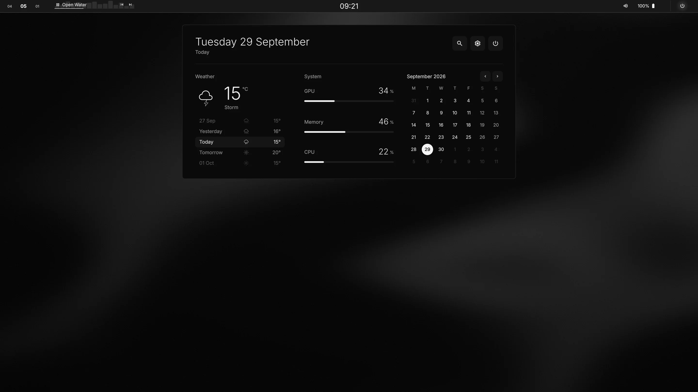
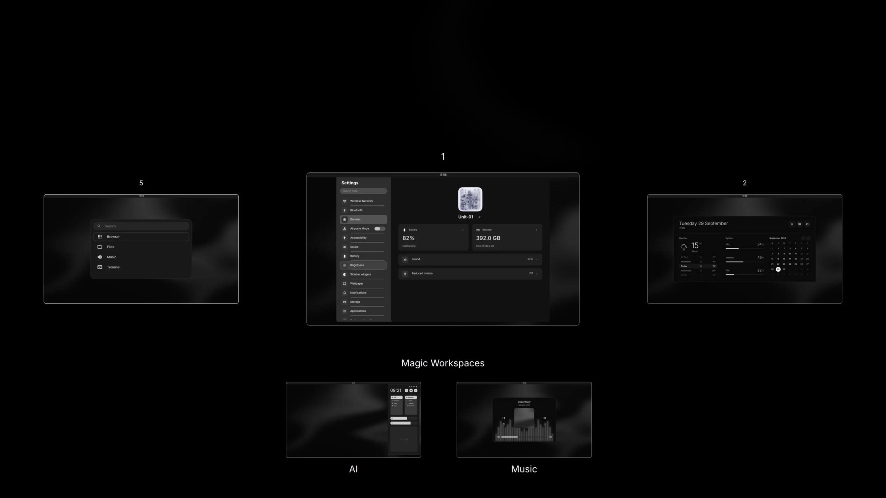
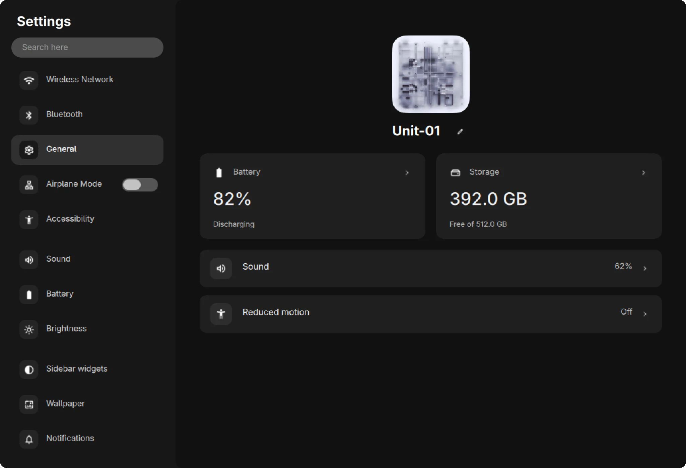
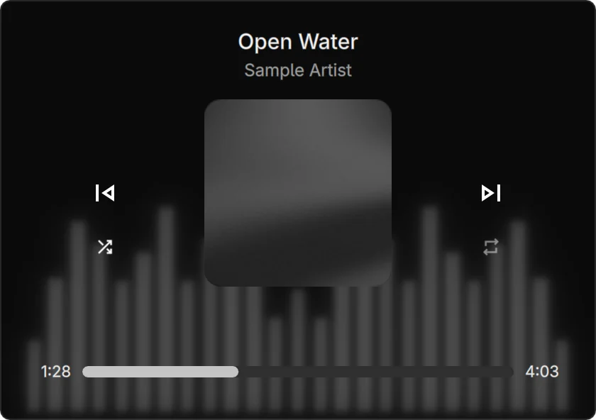
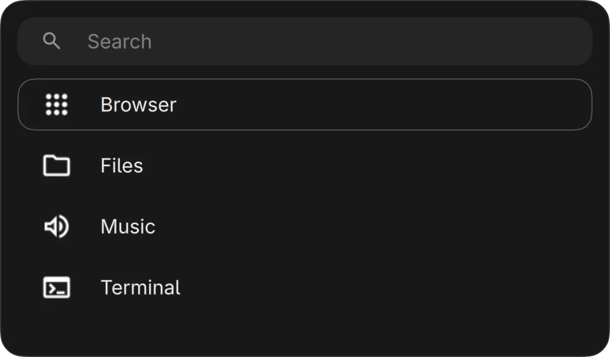

<h1 align="center">ghOSt</h1>

<p align="center">
  A monochrome desktop shell for Arch Linux and Hyprland, built with Quickshell.<br>
  <b>G</b>raphical <b>H</b>yprland <b>O</b>perating <b>S</b>ystem <b>T</b>oolkit
</p>

<p align="center">
  <a href="https://dsksnkz.github.io/ghOSt/">Website</a> ·
  <a href="#install">Install</a> ·
  <a href="docs/hyprland.md">Hyprland setup</a> ·
  <a href="docs/source.md">Source guide</a>
</p>



<p align="center"><sub>Designs are created in Figma by dsksnkz. Code was written with AI. Screens show sample data.</sub></p>

## What's included

| | |
| --- | --- |
| **Top bar** | Desktops, clock, volume, battery and power. The current track appears only while audio plays. |
| **Desktop switcher** | Super+Tab shows every desktop and Magic Workspace. Scroll or use the arrows, click to go there. |
| **Calendar** | Dates, weather and live system readings under the clock. |
| **Sidebar** | Network, Bluetooth, audio, brightness and notifications. |
| **Music player** | Artwork over a live spectrum of whatever is playing. |
| **Launcher** | Super+Space searches installed apps and keeps pinned favourites. |
| **Settings** | Fourteen pages and one search field, including wallpaper and the top bar layout. |
| **Lock screen** | A clock over your wallpaper. Any key brings up your picture and the password field. |
| **Login theme** | An optional SDDM theme, [installed separately](docs/sddm.md). |

<table>
  <tr>
    <td width="50%"></td>
    <td width="50%"></td>
  </tr>
  <tr>
    <td></td>
    <td></td>
  </tr>
</table>

## Install

You need Arch Linux with Hyprland, Quickshell and Python 3.

```sh
git clone https://github.com/dsksnkz/ghOSt.git
cd ghOSt
./install.sh --activate
```

This installs missing packages after asking for your password, copies ghOSt into place, adds it to your Hyprland startup and starts it.

**Back up anything you've customised.** Your existing files are snapshotted and can be restored, but these are replaced:

- `~/.bashrc`, the fish config, and the fastfetch and cava configs. Use `--no-shell-config` to keep yours.
- On a stock Hyprland config, ghOSt also adds its shortcuts and the `awww` wallpaper daemon. A config that already has ghOSt shortcuts keeps them.

ghOSt doesn't turn off another bar, so stop any you already run. Network, Bluetooth and power profile controls need their system services enabled, which the installer leaves to you.

| Option | What it does |
| --- | --- |
| `./install.sh` | Stages the files without changing your desktop |
| `--activate` | Installs and starts ghOSt |
| `--no-start` | Installs without starting it |
| `--no-packages` | Lists missing packages instead of installing them |
| `--no-shell-config` | Keeps your shell, fastfetch and cava configs |
| `--restore` | Puts back what the install changed |

Snapshots are kept in `~/.local/state/ghost/backups`. If you've edited a file since installing, `--restore` stops and tells you which one.

## Use it

| Shortcut | Action |
| --- | --- |
| <kbd>Super</kbd> + <kbd>Space</kbd> | Launcher |
| <kbd>Super</kbd> + <kbd>Tab</kbd> | Desktop switcher |
| <kbd>Super</kbd> + <kbd>I</kbd> | Settings |
| <kbd>Super</kbd> + <kbd>L</kbd> | Lock |

More optional shortcuts are in [Hyprland setup](docs/hyprland.md).

| Command | Action |
| --- | --- |
| `ghost shell` | Restart the shell |
| `ghost start` | Start the shell and keep it running |
| `ghost stop` | Stop the shell |
| `ghost lock` | Lock the session |

The shell restarts by itself if it exits unexpectedly, and the bar returns when a disconnected display does. Unplanned exits are logged in `~/.local/state/ghost/shell-restarts.log`. A lock screen that crashes reopens with the session still locked.

## More

- [Hyprland setup](docs/hyprland.md): rules, startup and optional shortcuts
- [Login theme](docs/sddm.md): the SDDM theme
- [Source guide](docs/source.md): how the code is laid out
- [Icons](docs/icons.md): Google Material SVG icons, bundled with their licence
- [Progress](docs/PROGRESS.md): build notes and what has been verified
