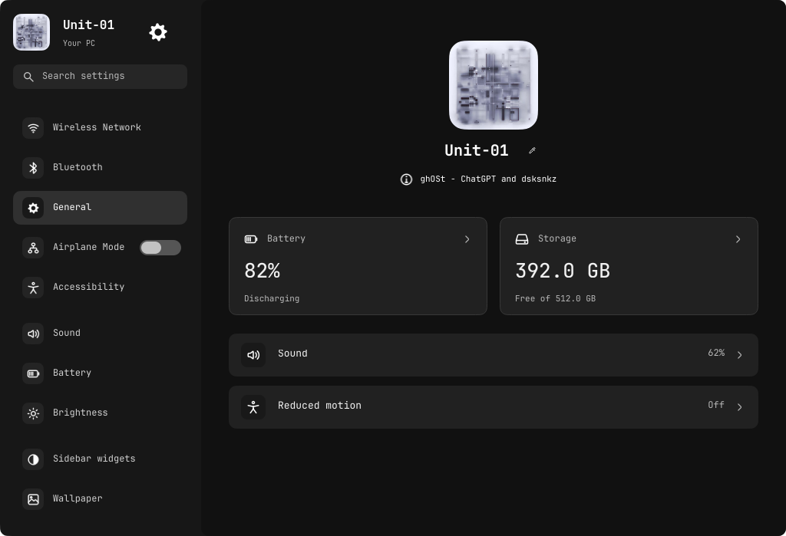
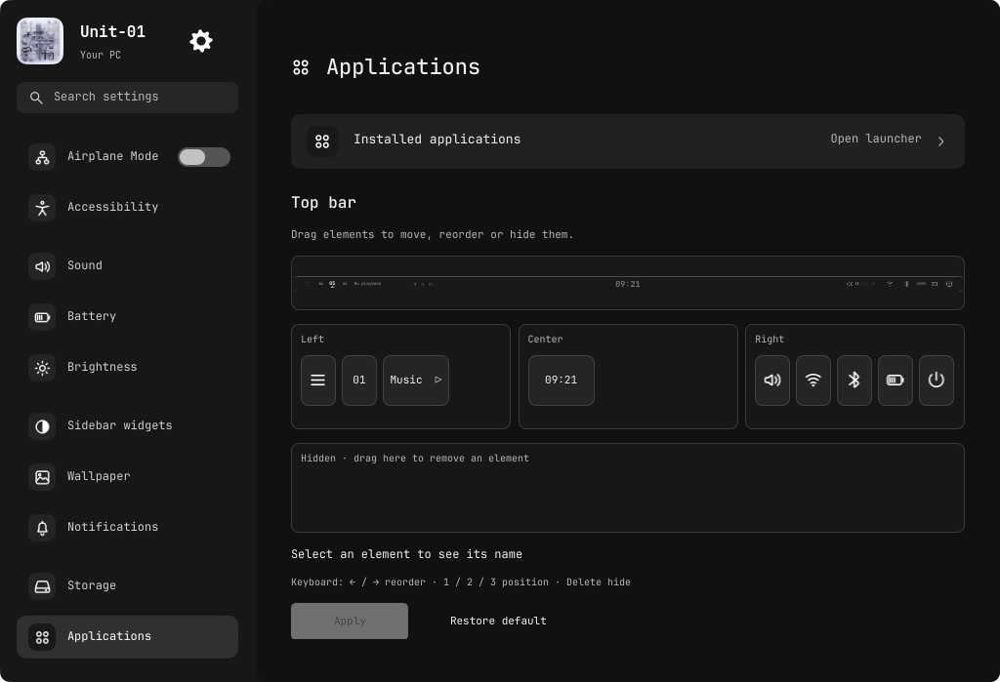
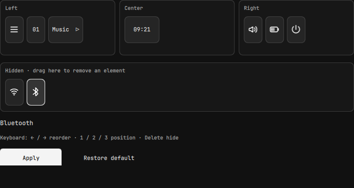

# Dark Settings and visual top-bar editing

Latest requests:

> change the settings to a darker theme, and add a function in applications where it lets the user control which elements exist in the top bar, including its location.

> not just like a list of stuff, make it like a preview of the top rail and use drag and stuff to change elements

The second request supersedes the initial list/dropdown editor. That intermediate
version was not published. Applications now contains an actual disabled `Rail`
render bound to a draft layout, followed by comfortable draggable element handles
in Left/Center/Right regions and a Hidden tray. This is not a website mockup.

## Behavior

- Drag handles between regions to reposition; drop on another handle's left or
  right half to insert before/after. Drag to Hidden to remove; drag back to restore.
  Dropping outside a target cancels. The preview follows the draft immediately.
- Select a handle to see its name. Keyboard alternatives: left/right reorder,
  1/2/3 position, Delete hide. No hover text or hover scaling.
- Apply persists the entire validated layout through existing Settings actions;
  the real rail updates from returned preferences without a shell restart.
  Restore default returns the original geometry, centered-clock-only middle,
  element order and dividers. Draft changes alone never alter the desktop.
- Nine existing elements are supported: sidebar button, workspaces, music,
  clock, volume, network, Bluetooth, battery and power. Hiding is visual, not
  disabling the underlying service. Keybindings are unchanged, including access
  to Settings even if all rail controls are hidden.
- Custom layouts use compact group spacing and omit the two fixed-position
  decorative divider strokes so they cannot be stranded over relocated controls.
  Groups avoid overlaps; the center yields only if a side group needs room.
- Settings uses #111111 content, #171717 sidebar, #212121 cards and unchanged
  light text. Input/selection/focus surfaces stay distinct. Existing geometry,
  corner system and animation timings are preserved. Compositing the navigation
  viewport fixes G2 icon wells drawing beyond its clip during scrolling.

## Files, safety and verification

`RailLayout.js` owns the catalogue, immutable moves/insertion and geometry.
`TopBarEditor.qml` owns draft state and internal pointer drags. Its preview is
disabled and its music sampling inactive: editing does not execute rail actions.
`settings_backend.py` accepts exactly one known entry per element with one valid
zone, writes atomically to the existing private preferences file, and preserves
other preferences. Malformed saved layouts fall back to the original layout.

Verified with actual offscreen Qt pointer/key events: hide by dragging, restore
to another region, keyboard hide, insertion/reorder, staged confirmation, moved
rail controls, retained clock action and original-default centering. Pure JS
checks cover immutable placement and sampled no-overlap geometry; backend tests
cover persistence, reset, corruption and validation. All 76 Python tests,
surface compile, existing input/Settings/weather tests and rail clock pass.
Website catalogue tests pass. No power, network, Bluetooth, wallpaper or session
actions are executed by these tests.

Affected project/live files and original preferences were snapshotted under
`.local/backups/2026-10-23-rail-layout/`. Six runtime files deployed to the named
ghOSt profile, reloaded and Applications opened for native inspection. No layout
was chosen or applied by the agent. The user can edit/apply it themselves.
Full native captures containing desktop/media context remain private. The native
controls-only crop excludes that context; full public renders use isolated
fixture data. Pages General/Applications captures updated; other existing page
captures have not been regenerated and retain their previous palette.

