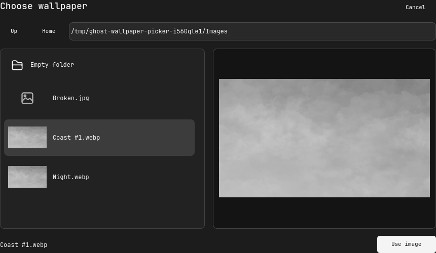

# Wallpaper image browser

The wallpaper button previously opened `QtQuick.Dialogs.FileDialog`, whose
separate native/fallback chooser did not inherit the Nautilus-only dark palette
and offered no integrated large image preview. Replaced only this chooser with
`WallpaperPicker.qml`, keeping the existing wallpaper backend and explicit
confirmation flow. Sound/profile choosers and other applications are unchanged.

## Behavior

- Neutral dark window, folder list, path field and preview surfaces; explicit
  light text, readable selection and focus states.
- Readable folders first, PNG/JPEG/WebP/BMP thumbnails and a larger aspect-fit
  preview. Image selection never changes the wallpaper by itself.
- Double-click or Enter opens a folder. Up/Home/path entry navigate; arrow keys
  select entries. Escape or Cancel closes without applying. Use image is disabled
  until the preview decodes successfully. Unreadable images show an error.
- Space/hash/question-mark filenames are encoded correctly. Existing wallpaper
  starts in its directory if a saved preference exists; otherwise Home.
- Asynchronous thumbnails decode to bounded 152×112 pixels; preview to at most
  1024×768. Delegates are virtualized and selected image cleared on closing.
- Popup follows the Settings scene scale, rather than inheriting system dialog
  colors. No packages, global Qt theme overrides, shortcuts or services changed.

## Verification and deployment

`python scripts/verify_wallpaper_picker.py` runs real Qt mouse/key input on an
offscreen window with a temporary folder and public sample artwork. It verifies
filtering, thumbnails/preview render, selection, keyboard navigation, directory
entry, explicit confirmation, Escape, unreadable-image rejection and URL encoding.
Only a signal spy receives confirmation; no wallpaper backend runs in this test.
Production surface compile, rail input, Settings routing and all 74 Python tests
pass. Pages' existing Wallpaper selection displays the new actual component
render; no extra top-level website section was added.

Deployed the picker, module registration, Settings page and window diagnostics
to the existing named ghOSt profile. Reload succeeded without QML errors.
Opened Settings → Wallpaper → chooser on the running desktop and inspected its
dark palette, readable text and layout. No saved wallpaper preference exists in
this session, so this native opening starts at Home with no image selected.
Image selection/confirmation behavior was verified offscreen; the live wallpaper
was deliberately not changed. Native full-screen capture stays private locally.
The public image below is an actual Qt component render with sample image names
and the already-exported public wallpaper, not personal folder contents.

Recovery snapshot: `.local/backups/2026-10-23-wallpaper-picker/` contains the
affected existing project/live files. `WallpaperPicker.qml` is newly added.

