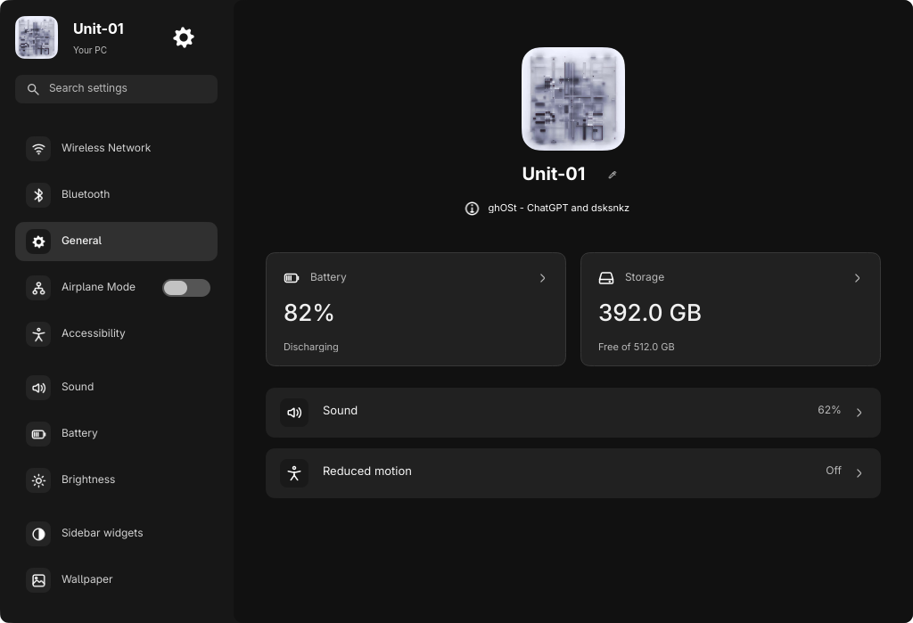

# Reversible sans-serif font trial

Requests:

> change the font to a macos like font for everything, lets see how it looks and if it looks bad ill reverse it

> some font weight is too high, not change the font weight to light but decrease by alittle

Uses the already-installed **Adwaita Sans** as the clean system-sans trial, not
Apple's proprietary font. No fonts or packages were downloaded or installed.
The latest user request explicitly supersedes the previous JetBrains-only text
direction for this trial. Existing sizes, layout geometry, spacing, animation
timings, colors and icons are unchanged.

## Applied scope

- Shared ghOSt label/profile fonts, meter labels and the visual lock scene use
  the same family. Original bundled JetBrains/Turret Road font files remain.
- Heavier ghOSt text steps down by only 50 weight points: Medium 500→450,
  DemiBold 600→550 and Bold 700→650. Regular text and pre-existing Light styles
  are unchanged; no heavy label was converted to Light.
- GTK3/GTK4, GNOME interface/document/title defaults, Qt6ct general font, KDE
  general/menu/toolbar/title defaults, and generic sans-serif/system-ui aliases
  use the trial family. Desktop default point size remains 10.
- Monospace/code font preferences, icon fonts, cursor/theme settings and app
  content fonts are not overridden. The separately running launcher requests
  Inter; fontconfig now resolves that absent family to Adwaita Sans without
  editing or importing the independently changed launcher source.
- Applications with their own fonts may ignore system defaults. Existing apps
  can require reopening. No applications were forcibly restarted, and no claim
  is made that every application's internal typography has been changed.

## Verification

Fontconfig resolves Adwaita Sans, generic sans-serif and the absent Inter request
to the installed family. GSettings reports the new UI default. Actual running
ghOSt reports the new profile family. Inspected the native rail and isolated
Settings render. Input, rail centering, launcher motion/commands, wallpaper
picker, workspace-wheel logic, visual/mock lock and production compilation pass.
No real lock, authentication or session action was performed.
All 81 Python tests pass, including exact desktop-font apply/restore, unchanged
fixed/code-font settings, and refusal to overwrite later edits during restore.
The first workspace-wheel verifier invocation lacked its required IPC arguments;
it did not run. The pure workspace-wheel tests were run successfully instead.

Safe fixture captures show the family and reduced emphasis weights. General,
Applications and rail website captures are updated; other older website captures
have not been regenerated and may still show the previous typeface.

## Recovery

Shell source/live originals are under
`.local/backups/2026-10-24-font-trial/{project,live}/`, including the weight-bearing
components. Desktop preferences have an independent private snapshot under
`~/.local/state/ghost/backups/font-20261024-162038-719978/`.

To restore desktop defaults, use the recorded snapshot with:

```sh
python scripts/desktop_font_trial.py --restore /path/to/font-snapshot
```

The restore checks every affected file and font preference against its installed
trial value before changing anything. It refuses if later edits would be lost.
Restore only the matching shell font/weight files from the shell snapshot, after
checking for later edits, then reload the named ghOSt instance. These recovery
snapshots contain local settings and are deliberately not published.



