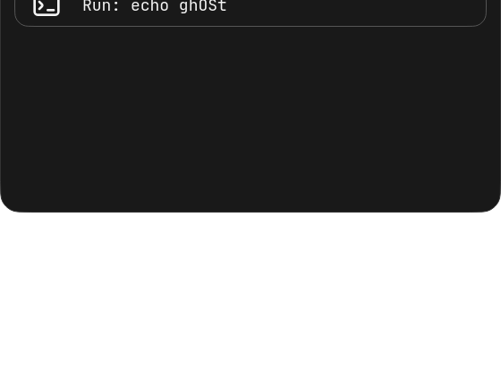
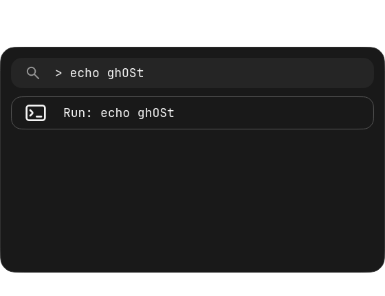

# Launcher: slide from above, behind the rail

Requests:

> super space app launcher animation should be the app launcher sliding from top to position without scale change

> make it spawn behind the top rail

Only the launcher entrance/exit is changed. Its native window moves from above
the screen to top margin 68 using the existing 220ms OutCubic reveal animation.
No content scaling or fading is applied to the launcher; the nested page-loader
fade is also skipped. The frame is fixed at 560×328 (width remains responsive on
narrow screens), including while the loader initializes. Reduced motion still
sets the existing reveal animation to zero duration. Closing reverses the slide.

The launcher uses WlrLayer.Top while the rail stays on WlrLayer.Overlay. Other
popup pages remain on their previous layer and retain their existing transforms.
No shortcut, launcher geometry at rest, search/navigation behavior, settings,
wallpaper, services, Hyprland configuration or other surface was changed.

## Verification

- Offscreen actual PanelContent render/input test samples reveal 0, .25, .6 and 1.
  Its transformed bounds remain 560×328, opacity and scales stay 1, start is fully
  above the screen, and final top is 68. Other-popup transform values are checked.
- Existing launcher tests pass: query reset, keyboard movement, animated row
  selection/scroll, Escape and command handling. Preview tests never execute the
  sample command. Surface compilation and all 76 Python tests pass.
- Deployed three files to the existing ghOSt profile and reloaded the named
  instance. Opened the actual launcher for inspection. Native compositor reports
  launcher layer 2 below rail layer 3, y=-328 initially and y=68 settled, with
  width=560 and height=328. Before the fixed-loader-height correction, an entirely
  offscreen 80px initialization frame was observed; the final version maps with
  the fixed full height instead. No QML reload errors.
- Safe screenshots below are actual Qt component renders with one inert sample
  command, not private desktop contents. Pages' existing launcher view updated.
  Native fullscreen interaction was not separately tested.

Recovery: `.local/backups/2026-10-24-launcher-slide/` contains original project and
live Panel/PanelContent copies. PanelMotion.js is newly added.

