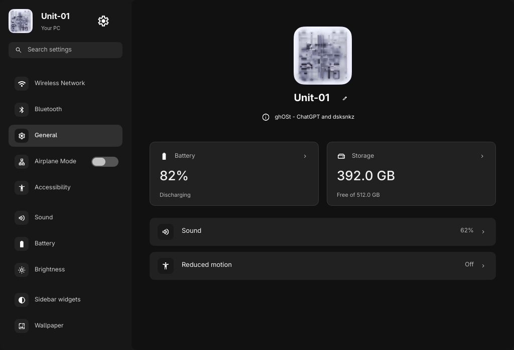
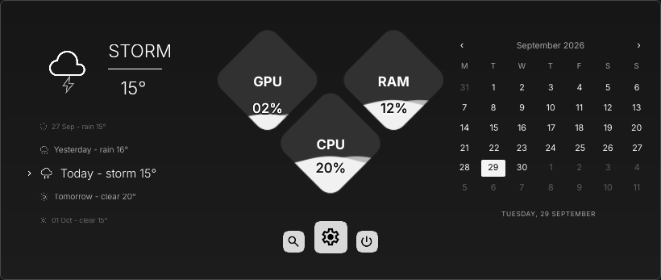
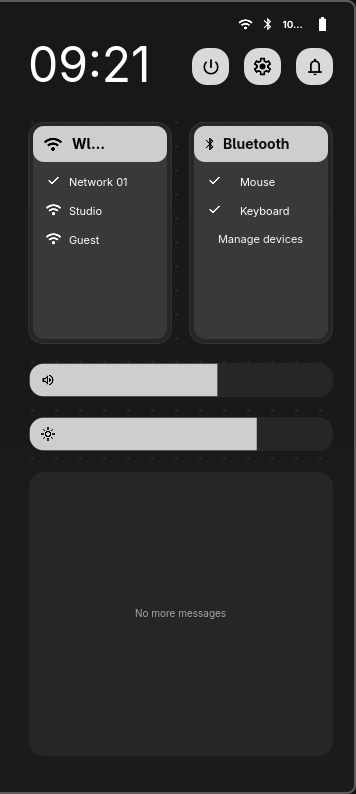

# Google Material icons and sampling correction

User chose Google Material after the Iconic pack coverage check, authorized
publication, then reported blurry icons. This replaces the shared pack, not the
desktop layout. Official Material Symbols Outlined covers every existing control
ID. Six weather sources use weight200, ordinary controls400. The G remains the
brand mark. Third-party application logos, inherited system icons and the separate
external `ghost-launcher` configuration remain unchanged.

## Implementation

Vendored upstream SVGs, pinned revision and SHA-256 provenance; offline generator
normalizes both Google coordinate conventions (24 and960 units). One-pixel margin
avoids clipped wide symbols. Black/white exports, light weather variants and
licences are shared by native QML and Pages. The existing folder overlay now uses
Material folder SVGs, with GTK symbolic recoloring and inherited nonfolder icons.

The initial live reload retained old textures for unchanged asset URLs. A pack
cache version corrects this while keeping caching enabled. Small icons previously
rasterized at their logical12–18px size before fractional parent scaling. They now
cache at twice device resolution, minimum48px, with mipmaps for downsampling.
This is a sampling correction, not an increase in logical icon/control dimensions.
It does not eliminate normal edge antialiasing at very small fractional sizes.

## Verification

All shared icons rendered in both tones at24/48px: nonempty, transparent, bounded,
matching alpha and pure colors. Source checksums and offline freshness verified.
Real Qt tests cover loaded icons at12/18/24/108px under a0.7 parent scale with
unchanged logical sizes and high-resolution source textures. Production compile,
input/dismissal/weather/music and rail centering checks pass. Settings fixture
verifier covers all14pages. Python suite and site capture/motion tests pass.

Deployed only canonical icon files, `SvgIcon.qml` and the existing Files folder
overlay; rebuilt its cache. Reloaded named ghOSt, inspected actual rail and
Settings, confirmed `Configuration Loaded`. No keybind, desktop geometry, media,
session/power action, wallpaper, service or package changes. No actual lock tested.

Safe cropped component output:

These use labelled fixture data, not fabricated live telemetry. Full native
desktop captures were inspected locally only; private chats/music were excluded.
Pages Settings/calendar/sidebar captures and downloadable SVG gallery updated.
Older rail/launcher/wallpaper screenshots are not refreshed by this pass.

## Recovery and references

Exact originals: `.local/backups/2026-10-24-material-icons/{project,live}/`.
The live snapshot includes the prior folder overlay. Restore affected icon files
and `SvgIcon.qml` together, then reload only ghOSt and refresh the folder cache.
Tracked source history also retains the previous generated pack and generator.
Unrelated untracked assets/scripts were preserved.

Before building, remote prompts.md and both mainDesigns blobs matched local
hashes (`f1c5f9e`, `8b13789`, `9cc34c7`); supplied composition inspected. Latest
direct pack request supersedes its old icon artwork. No full design-parity claim.
Publication includes only the implementation, licences, docs and safe captures.
