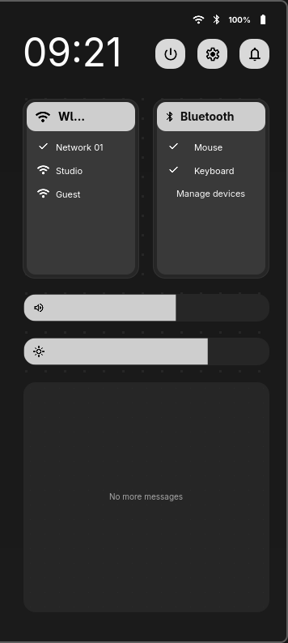

# Rail corrections, edge volume and ghOSt Intro

## Requested changes

- Rail internet artwork is always Wi-Fi, even over Ethernet. Actual connectivity
  and names in Settings remain accurate; no network configuration changed.
- Rail controls share22px icon boxes; sidebar status symbols and its three header
  actions also share22px within their respective groups. Media controls retain
  their separate common size. No global icon stretching or text/layout scaling.
- Sidebar percentage gets42px and no ellipsis:100% fits in the scaled group.
- Workspace marker is a stationary6px filled white dot, not a compressed SVG
  triangle. Wheel animation, eligible workspaces and keybinds remain unchanged.
- Removed volume from the rail and editor catalogue. Preferences accept the new
  eight-element schema, migrating old saved layouts without reordering anything
  except dropping the obsolete volume entry. Other preferences stay untouched.
- Removed the sidebar edge action. Two transparent2px edge windows cover only
  the middle, up to280px tall. A120ms hover shows the existing OSD on that side;
  scroll changes2% at a time or use its touch/drag slider. Top/bottom are dead
  zones. Fullscreen outputs do not get edge interception. Hover never changes
  volume; no full-screen input layer or keyboard grab was added.
- Added [ghOSt Intro](../intro.md): searchable local tutorials, three recommended
  starting topics, explicit buttons to real surfaces, Escape/close, and a native
  constrained floating window. No recommended setting is silently applied.

The installed taste skill informed readable hierarchy/contrast in Intro. Its web
hero/randomization/GSAP conventions conflict with native QML and the explicit
ghOSt visual contract, so those were not applied. Existing typography and material
remain in use; no replacement design system or unrelated app styling.

## Verification

83 Python tests pass, including legacy rail preference migration; production QML
compilation, real offscreen dismissal/input, rail centering/equal-height checks,
editor drag integration and all14 Settings pages pass. Pure JS tests cover Intro
search/recommendations and edge dead-zone geometry/volume clamping. Real Qt input
types a query, selects an explicit route, handles empty/reset states and Escape.
Site capture/motion tests pass. One fixture IPC attempt failed during an automatic
reload; restarting only that offscreen fixture resolved it and the full verifier
passed. No broken fixture was left running.

Native app entry launched via GIO and reports floating:true,fullscreen:0,size860×620.
Title-specific compositor rule suppresses client maximize/fullscreen requests;
deliberate compositor commands that forcibly override rules are not prohibited.
Native layer geometry matches both2×280 targets aty400 on1080p. Opt-in pointer
test exercises both middle hovers, upper/lower dead zones and expiry, verifies
unchanged volume, then restores the cursor. It never clicks or scrolls. A legacy
hyprctl cursor command was rejected before moving anything; native testing used
the already-running ydotool service instead. No service installed/started.

Updated active ghOSt modules only, installed the app entry/G icon, added only the
Intro floating rule to the existing Hyprland autostart module and reloaded it.
Hyprland reports no config errors; ghOSt reload logs show Configuration Loaded.
No keybinding file, wallpaper, power/session, hardware, authentication or network
configuration changed. OSD slider/service behavior is retained; this pass did not
automate a real volume adjustment. Native multi-monitor input was not exercised.

## Captures and recovery

Intro capture is its actual native content; other captures are isolated sample
data. Fixture bus was disconnected to exclude private MPRIS titles. Existing
Pages rail/sidebar/Settings/calendar assets refreshed; no additional preview
surface or website redesign. No private desktop captures published.

Project/live module originals and exact previous autostart file are under
`.local/backups/2026-10-24-rail-edge-intro/`. Entry/icon helper records exact old
paths or prior absence in `~/.local/state/ghost/backups/intro-20261024-220438-999425/`.
Restore affected modules and the Intro rule only; preserve unrelated later edits.
Source and live preference data were not broadly reset. Unrelated untracked
AGENTS/design/capture files remain untouched.

Remote prompts/mainDesigns hashes matched the previously inspected source; latest
direct corrections override older artwork. No full-project completion/parity claim.
