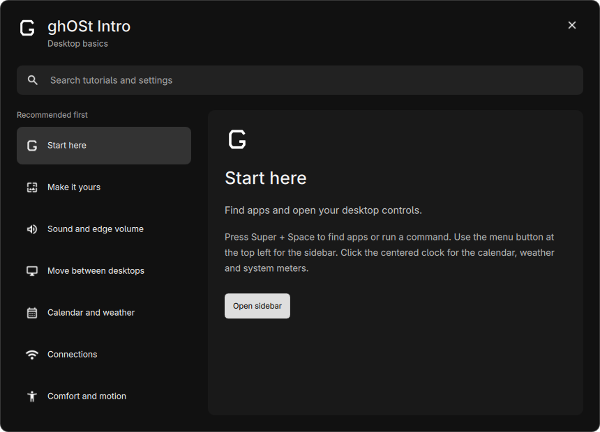

# ghOSt Intro

Launch **ghOSt Intro** from the application launcher, or run:

```sh
quickshell ipc -c ghost-bar call bar intro
```

The ghOSt bar must be running. The app starts with three recommended topics:
desktop basics, wallpaper and sound. Search at the top filters seven local
tutorials by words, including Ethernet, workspaces, click sounds and weather.
Select a topic to read it; its button opens the corresponding real ghOSt surface.
Nothing changes automatically. Escape or the close button closes Intro.

It is a centered, floating 860 × 620 window with constrained resizing, not a
fullscreen/tiled welcome overlay. Its title-specific Hyprland rule sets floating,
clears initial fullscreen and suppresses maximize/fullscreen client requests.
No autostart, onboarding tracking, account requirement or package installation.

The regular activation installer installs its desktop entry and G icon. For an
already deployed profile, copy the Intro QML/JS files and updated shell/qmldir,
add the `ghost-intro` rule from `config/hypr/ghost-rules.lua`, then run
`python3 scripts/install_intro.py --apply`. The helper snapshots exact existing
entry/icon files before installing. It does not replace the icon theme.



## Edge volume

The rail no longer has a volume element. Hover anywhere along either left/right
edge for120ms to reveal the existing OSD on that side. The active region is2px
wide and covers the full height, not just the center. The OSD centers vertically
on the pointer, clamped near the top/bottom to stay on-screen. Pointer tracking
is coalesced to at most one window-position update per16ms, only while active.
Fullscreen outputs disable the edge targets.
Hovering alone never changes volume. Scroll in2% steps or drag/touch the OSD
slider; it expires after2.2seconds without interaction. Brightness keys keep
their existing OSD. The menu button still opens the sidebar; edges never do.
