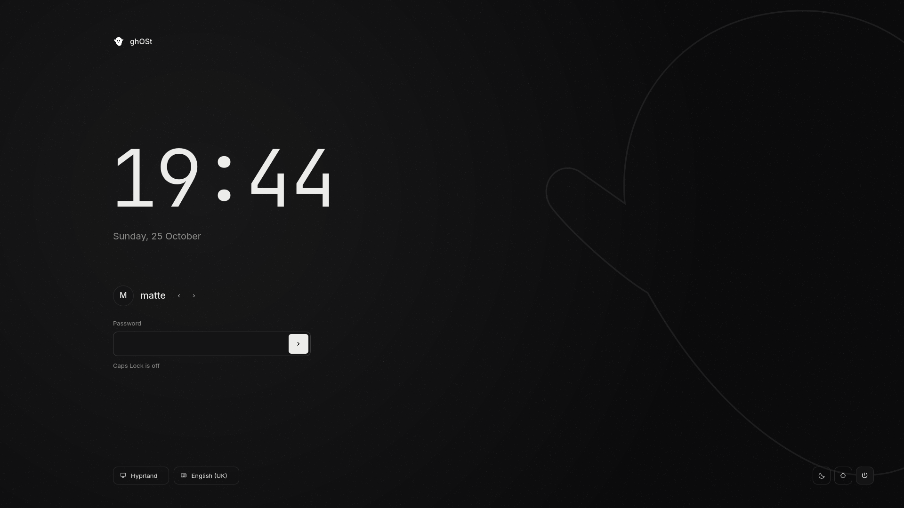

# SDDM theme

`config/sddm/ghost/` is a self-contained SDDM greeter theme (Qt 6, SDDM 0.21+),
built from the chosen login mockup (direction B, editorial left). It is **not
installed or applied** by any ghOSt script; `scripts/install.py` never touches it.



## What it does

- Clock and date (formats in `theme.conf`), updated every second.
- User: initial and name from SDDM's user model, starting at the last user.
  Arrows switch between users when there is more than one.
- Password field with a label above it; Enter or the arrow button signs in with
  the selected user and session. A wrong password shakes the field, clears it and
  shows "Incorrect password". Caps Lock state is shown under the field.
- Session and keyboard-layout buttons cycle through SDDM's sessions and layouts.
- Sleep, restart and power buttons only appear when SDDM reports them available.
- Background: off-black field, soft light, fine grain, and an optional faint
  ghost outline (`watermark=false` in `theme.conf` turns it off).
- Fonts, icons and the outline are bundled under `assets/` with their licences.
  It does not depend on the ghOSt shell being installed. Text uses Adwaita Sans
  from the system.

## Verify without SDDM

```sh
python3 scripts/verify_sddm_theme.py config/sddm/ghost/preview.png
```

This loads `Main.qml` offscreen with stand-in SDDM objects (`tests/sddm-theme.qml`),
renders the preview, and checks sign-in arguments, the failure message, Caps Lock
text, and session and layout cycling. It never contacts the SDDM daemon.

SDDM's own preview opens a window on the desktop but does not change the login screen:

```sh
sddm-greeter-qt6 --test-mode --theme config/sddm/ghost
```

## Installing (manual, not done by ghOSt)

Changing the login screen is a system change. ghOSt's rules exclude SDDM, so these
steps are for the user to run deliberately, after the test-mode preview:

```sh
sudo cp -r config/sddm/ghost /usr/share/sddm/themes/ghost
```

Then set `Current=ghost` under `[Theme]` in a file in `/etc/sddm.conf.d/`. Keep a
working theme name noted so it can be restored from a TTY if needed.
